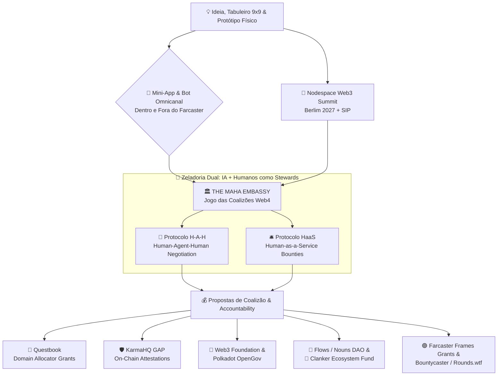

# 🏛️🐍 Maha Grid & The Embassy — Governança Web4 Agêntica, H-A-H, HaaS & Jogo Phygital (9 Ciclos)

> **Bem Público Financiável (Web3 + Web4 Agêntica)**: *Onde IA e Humanos atuam como Stewards/Zeladores (`Human-Agent-Human` e `Human-as-a-Service`) no Jogo das Coalizões para DAO Proposals — operando dentro e fora do Farcaster, validado presencialmente no Nodespace (Web3 Summit Berlim 2027) e estruturado para Questbook, KarmaHQ (GAP), Web3 Foundation, Polkadot OpenGov, Flows (Nouns DAO) e Clanker Ecosystem Fund.*

---

## 🗺️ 1. Visão Macro & Topologia Web4 Agêntica (The Embassy)



---

## 📂 2. Mapa Completo de Documentos, Modelos de Grants e Specs

### 🧠 Especificações Web4 Agêntica, Etnografia Cibernética, Embassy, Bot & Mini-App (Dentro e Fora do Farcaster)
| Arquivo | Descrição |
| :--- | :--- |
| [`docs/etnografia-web4-neynar-simulacro-regenerativo.md`](./docs/etnografia-web4-neynar-simulacro-regenerativo.md) | **Etnografia Cibernética Web4 & Data Storytelling**: Outline com glifos Unicode (`⟁`, `◈`, `⌬`, `⧬`, `⟡`), formalismos simbólicos, filosofemas (Baudrillard invertido / Simulacro Positivo, Efeito Observador de von Foerster, Stewardship de Zargham/Ostrom), autoetnografia no grafo social, modelagem `H-A-H`/`HaaS`/`A2H`, dados sintéticos pós-intervenção e guia Tri-Token com Neynar. |
| [`src/neynar_scribe_client.mjs`](./src/neynar_scribe_client.mjs) | **Cliente Oficial `@neynar/nodejs-sdk` & Orquestrador Tri-Token**: Indexa o Perfil Autoetnográfico Vivo (`◈`), compõe a Crônica Edificante do Escriba (`⟁`) e estrutura transações de **Tokens Mercantis (`USDC`/`DOT`/`$DEGEN`/`$CLANKER`), Reputacionais (`MAHA-SBT`) e de Governança (`Shapley/Conviction`)**. |
| [`specs/01-embassy-web4-hah-haas-architecture.md`](./specs/01-embassy-web4-hah-haas-architecture.md) | Arquitetura da **Embassy** adaptada para o Jogo das Coalizões em DAO Proposals: Zeladoria Dual (AI + Human Stewards), fluxo **H-A-H (`Human-Agent-Human`)** e marketplace **HaaS (`Human-as-a-Service`)**. |
| [`specs/02-omnifront-bot-and-miniapp-spec.md`](./specs/02-omnifront-bot-and-miniapp-spec.md) | Especificação completa do **`@maha-embassy-bot`** e do **Mini-App Omnicanal** com paridade dentro do Farcaster (`fc:frame` v2, Neynar webhooks) e fora do Farcaster (Standalone Web4 PWA, Telegram/Discord, REST & MCP Server). |
| [`specs/03-graph-theory-network-science-surfpool-spec.md`](./specs/03-graph-theory-network-science-surfpool-spec.md) | **Especificação de Graph Theory, Network Science & Rede Virtual de Carteiras no Surfpool (`v1.7.0`)**: Grafo Multiplex Tri-Token ($\mathcal{G}^{[3]}$), Matriz Laplaciana e Valor de Fiedler ($\lambda_2$), Centralidade do Escriba ($C_B$), topologia de 36 carteiras/PDAs e lei de conservação de capital. |
| [`specs/04-neynar-v2-azer-bot-and-apk-spec.md`](./specs/04-neynar-v2-azer-bot-and-apk-spec.md) | **Especificação do APK Android & Cérebro do Bot Etnógrafo `"a zer"` (`Neynar API V2` + `Farcaster Hub API`)**: Mapeamento integral das 21 categorias da API V2 da Neynar e 12 categorias da Hub API para as camadas `L0 Scout`, `L1 Envoy`, `L2 Escriba` e `L3 Treasury/DeFAI`. |
| [`specs/05-unified-api-gateway-farcaster-github-questbook-karmahq.md`](./specs/05-unified-api-gateway-farcaster-github-questbook-karmahq.md) | **Especificação da Arquitetura Quad-API (`Farcaster` × `GitHub` × `Questbook` × `KarmaHQ GAP`)**: Barramento unificado que conecta commits/releases no GitHub a atestações EAS no KarmaHQ, mutações GraphQL de milestones no Questbook e Frames DeFAI no Farcaster. |
| [`specs/06-web4-web5-hypercoordination-proofgate-and-gap-mitigations.md`](./specs/06-web4-web5-hypercoordination-proofgate-and-gap-mitigations.md) | **Adaptação Web4 (Web Agêntica / `"Algorithm as Policy"` via `ProofGate`) & Web5 (Web Soberana Individual / `Indivíduo → Coletivo`, `H2A` / `A2H`, `Playground.dot` E-sport) + Mitigação Técnica dos 5 Gaps Críticos**. |
| [`src/web5_proofgate_hypercoordination.py`](./src/web5_proofgate_hypercoordination.py) | **Motor Executável Web4/Web5 & ProofGate (`npm run web5:proofgate`)**: Implementa `ProofGatePolicyEngine` (Circuit Breaker estatístico $\mu+2\sigma$), `CognitiveA2HProtocol` (Anti-Rubber-Stamping), `Web5SovereignPod` (ZK-Predicates), `PlaygroundDotEsportArena` (WIP-Gated E-sport) e `SovereignPermaLedger` (`SBT + EAS + IPFS + Arweave`), gerando [`simulations/output/web5_proofgate_hypercoordination.json`](./simulations/output/web5_proofgate_hypercoordination.json). |
| [`docs/relatorio-e2e-playwright-quad-api-karmahq-questbook.md`](./docs/relatorio-e2e-playwright-quad-api-karmahq-questbook.md) | **Relatório de Testes End-to-End (E2E) com Playwright & Guia Visual Passo-a-Passo**: 5 screenshots anotados (`1440×900`) mostrando onde clicar e preencher nos frontends do **Questbook**, **KarmaHQ GAP**, **Farcaster Neynar V2/Hub (Bot `"a zer"`)**, **GitHub** e **Maha Grid/Surfpool**. |
| [`tests/e2e_playwright_quad_api.spec.mjs`](./tests/e2e_playwright_quad_api.spec.mjs) | **Suíte Automatizada E2E (`npm run test:e2e`)**: Exercita todas as opções das 4 APIs, a malha de 36 carteiras no Surfpool, as 5 telas anotadas e o pacote Android APK. |
| [`src/azer_quad_api_adapter.mjs`](./src/azer_quad_api_adapter.mjs) | **Gateway Executável Quad-API (`npm run api:quad`)**: Implementa `FarcasterApiAdapter`, `GitHubApiAdapter`, `QuestbookApiAdapter`, `KarmaHqGapApiAdapter` e `AzerQuadApiGateway`, gerando [`simulations/output/azer_quad_api_sync_telemetry.json`](./simulations/output/azer_quad_api_sync_telemetry.json). |
| [`src/azer_neynar_v2_brain.mjs`](./src/azer_neynar_v2_brain.mjs) | **Módulo Executável do Bot `"a zer"` (`npm run azer:brain`)**: Implementa toda a matriz operacional da API V2 da Neynar + Hub API e gera [`simulations/output/azer_neynar_v2_matrix.json`](./simulations/output/azer_neynar_v2_matrix.json). |
| [`android-apk/dist/maha-grid-azer-embassy-v1.0.0.apk`](./android-apk/dist/maha-grid-azer-embassy-v1.0.0.apk) | **Pacote Instalável Android APK (`xyz.mahagrid.embassy.azer`)**: Gerado por [`scripts/build_apk.py`](./scripts/build_apk.py) (`npm run build:apk`) com `classes.dex`, `AndroidManifest.xml`, `resources.arsc`, assinatura `META-INF` e todos os painéis integrados. |
| [`simulations/surfpool_network_sim.py`](./simulations/surfpool_network_sim.py) | **Simulador de Rede Virtual de 36 Carteiras (Surfpool) & Análise Espectral**: Executa a cascata atômica `TX-01..TX-08`, calcula Fiedler $\lambda_2$, Betweenness de Brandes, Isolamento Sybil e gera [`simulations/output/surfpool_graph_network_report.md`](./simulations/output/surfpool_graph_network_report.md) e [`simulations/output/surfpool_wallet_graph.json`](./simulations/output/surfpool_wallet_graph.json). |
| [`src/embassy_agent_engine.py`](./src/embassy_agent_engine.py) | Motor executável em Python da **Embassy**: negociação H-A-H entre AI Stewards, detecção de conflitos, divisão pelo *Valor de Shapley*, despacho de tarefas HaaS e exportação JSON em [`simulations/output/embassy_coalition_bundle.json`](./simulations/output/embassy_coalition_bundle.json). |

### 💰 Modelos de Documentos para Grants, Questbook, KarmaHQ, Farcaster Frames & DAO Proposals
| Arquivo | Plataforma / Protocolo Alvo |
| :--- | :--- |
| [`grants/01-web3-foundation-polkadot.md`](./grants/01-web3-foundation-polkadot.md) | **Web3 Foundation Grants** ($30k em 3 milestones) & **Polkadot Treasury OpenGov Referendum** ($18k para Oficina Berlim + Kit Aberto). |
| [`grants/02-flows-nouns-and-clanker.md`](./grants/02-flows-nouns-and-clanker.md) | **Flows.wtf (Nouns DAO)** (streaming contínuo CC0) & **Clanker Ecosystem Fund (CEF)** (reciclagem de taxas Farcaster). |
| [`grants/03-questbook-grant-application.md`](./grants/03-questbook-grant-application.md) | **Questbook (DDA Model — Arbitrum / Compound / Polygon)**: rubrica de avaliação 5/5, KPIs verificáveis e orçamento detalhado por milestone. |
| [`grants/04-karmahq-gap-profile-and-milestones.md`](./grants/04-karmahq-gap-profile-and-milestones.md) | **KarmaHQ — GAP (Grantee Accountability Protocol)**: schema completo do projeto, status dos milestones e payload JSON de atestação EAS / Soulbound. |
| [`grants/05-farcaster-frames-grants-and-rounds.md`](./grants/05-farcaster-frames-grants-and-rounds.md) | **Farcaster Frames Grants (`Rounds.wtf`, `Bountycaster`, `Purple DAO`, `Base Builds`)**: templates de Casts, bounties HaaS e JSON dos Frames de ratificação de coalizão. |
| [`grants/06-embassy-dao-coalition-proposal-template.md`](./grants/06-embassy-dao-coalition-proposal-template.md) | **Modelo Oficial de DAO Proposal da Embassy**: Resumo de 3 pontos para votantes, auditoria de conflitos H-A-H, tabela de Valor de Shapley e assinaturas de Zeladoria Dual. |

### 🎲 Jogo Phygital, Simulação cadCAD/TokenSpice, Contratos SBT & Nodespace Berlim
| Arquivo | Descrição |
| :--- | :--- |
| [`index.html`](./index.html) | **Mini-App Interativo (In & Out Farcaster)**: Tabuleiro 9x9 (81 casas), Câmara Diplomática da Embassy (H-A-H / HaaS), exportador de templates (Questbook/KarmaHQ/Frames/Bot) e cunhagem SBT. |
| [`simulations/maha_grid_sim.py`](./simulations/maha_grid_sim.py) | Simulador estocástico estilo `cadCAD/TokenSpice` dos 9 Ciclos + relatório gerado em [`simulations/output/simulation_report.md`](./simulations/output/simulation_report.md). |
| [`contracts/MahaGridSBT.sol`](./contracts/MahaGridSBT.sol) | Contrato **Soulbound Token (ERC-5192)** para emissão da atestação não-transferível *"Completei a Jornada de 9 Ciclos do Maha Grid"*. |
| [`docs/rulebook-maha-grid.md`](./docs/rulebook-maha-grid.md) | Apostila Multilíngue (PT-BR / EN / DE) dos 9 Ciclos, 6 Escadas, 6 Serpentes e Diário de Bordo. |
| [`nodespace-berlin/01-nodespace-playbook-and-sip.md`](./nodespace-berlin/01-nodespace-playbook-and-sip.md) | E-mail para `contact@web3summit.com`, setup do Node físico e proposta de **SIP (Summit Improvement Proposal)**. |
| [`roadmap/90-day-execution-plan.md`](./roadmap/90-day-execution-plan.md) | Cronograma tático de 90 dias (Semanas 1–2, Semanas 3–4, Mês 2 e Mês 3). |

---

## 🚀 Como Executar e Testar Tudo Localmente

```bash
# 1. Rodar a simulação cadCAD/TokenSpice dos 9 Ciclos:
python3 simulations/maha_grid_sim.py

# 2. Rodar o motor de negociação H-A-H e despacho HaaS da Embassy:
python3 src/embassy_agent_engine.py

# 3. Executar a suíte completa de testes unitários (Tabuleiro + Simulação + Embassy H-A-H/HaaS):
python3 -m unittest discover -s simulations -p 'test_*.py'

# 4. Iniciar o Mini-App Omnicanal na porta 3000:
npm run dev
```

---

## 📜 Licença

Código e motores de simulação sob licença **MIT**; artefatos culturais, apostila multilíngue e templates da Embassy sob **CC0 / CC-BY-SA 4.0**.
