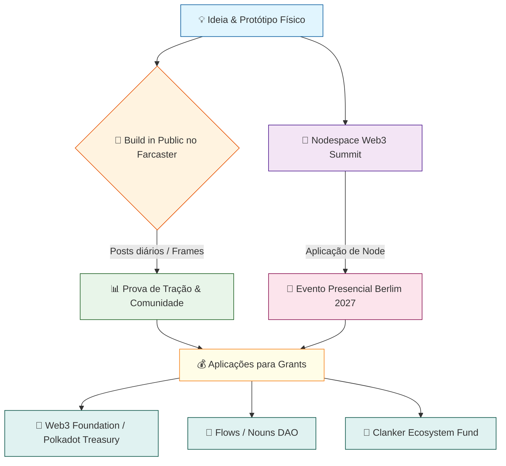

# 🐍🪜 Maha Grid — Governança Agêntica, Jogo Phygital (9 Ciclos) & Build-in-Public OS

> **Bem Público Financiável**: *Da concepção física e simulação econômica (cadCAD/TokenSpice) ao Farcaster Mini App (Frames v2), validação presencial no Nodespace (Web3 Summit Berlim 2027) e sustentabilidade multi-ecossistema (Web3 Foundation, Polkadot OpenGov, Flows/Nouns DAO e Clanker Ecosystem Fund).*

---

## 🗺️ O Fluxo de Trabalho (Visão Macro)

O diagrama abaixo resume o pipeline completo implementado neste repositório, integrando as três frentes paralelas:



---

## 📂 Arquitetura do Repositório

| Diretório / Arquivo | Frente Estratégica | Descrição Técnica |
| :--- | :--- | :--- |
| [`index.html`](./index.html) | **Frente 1 (Farcaster Mini App)** | App interativo com metadados `fc:frame` v2, Tabuleiro 9x9 (81 casas), "Frame Diário", Enquete de Serpentes, Simulador SBT e Gerador de Casts. |
| [`public/.well-known/farcaster.json`](./public/.well-known/farcaster.json) | **Frente 1 (Neynar / Frames v2)** | Manifesto oficial do Farcaster Mini App seguindo [miniapps.farcaster.xyz](https://miniapps.farcaster.xyz/). |
| [`docs/rulebook-maha-grid.md`](./docs/rulebook-maha-grid.md) | **Frente 1 & 2 (Regras & Diário)** | Apostila multilíngue (PT-BR / EN / DE) dos 9 Ciclos, 6 Escadas, 6 Serpentes e templates de Casts para `/web3`, `/dao`, `/gaming` e `/build`. |
| [`simulations/maha_grid_sim.py`](./simulations/maha_grid_sim.py) | **Frente 1 & 3 (cadCAD / TokenSpice)** | Motor Python de simulação estocástica de governança agêntica e tesouraria em 9 Ciclos + testes unitários ([`simulations/test_sim.py`](./simulations/test_sim.py)). |
| [`simulations/output/simulation_report.md`](./simulations/output/simulation_report.md) | **Prova de Mecanismo** | Relatório técnico automatizado com evolução de tesouraria, índice de Gini de reputação SBT e resistência a captura. |
| [`contracts/MahaGridSBT.sol`](./contracts/MahaGridSBT.sol) | **Frente 3 (Tokenização Phygital)** | Contrato Soulbound Token (ERC-5192) não-especulativo para emitir a atestação *"Completei a Jornada de 9 Ciclos do Maha Grid"*. |
| [`nodespace-berlin/01-nodespace-playbook-and-sip.md`](./nodespace-berlin/01-nodespace-playbook-and-sip.md) | **Frente 2 (Nodespace Berlim)** | E-mail pronto (EN/PT) para `contact@web3summit.com`, especificação física do Node, proposta de SIP e template de Relatório de Playtest. |
| [`grants/01-web3-foundation-polkadot.md`](./grants/01-web3-foundation-polkadot.md) | **Frente 3A (Infraestrutura)** | Aplicações completas para **Web3 Foundation Grants** e **Polkadot Treasury (OpenGov Referendum)**. |
| [`grants/02-flows-nouns-and-clanker.md`](./grants/02-flows-nouns-and-clanker.md) | **Frente 3B (Farcaster/Nouns)** | Aplicações completas para **Flows (Nouns DAO)** e **Clanker Ecosystem Fund (CEF)**. |
| [`roadmap/90-day-execution-plan.md`](./roadmap/90-day-execution-plan.md) | **Cronograma de 90 Dias** | Plano tático executável para Semanas 1–2, Semanas 3–4, Mês 2 e Mês 3. |

---

## 🚀 Como Executar Rapidamente

### 1. Rodar o Farcaster Mini App / Frame Diário Localmente
```bash
# Servir o Mini App interativo na porta 3000:
npm run dev
# Ou inicializar um novo scaffold Neynar Farcaster Mini App em < 60s:
npx @neynar/create-farcaster-mini-app@latest
```

### 2. Executar a Simulação cadCAD / TokenSpice e os Testes Automatizados
```bash
# Rodar a simulação de 24 épocas dos 9 Ciclos e gerar telemetria + relatório Markdown:
python3 simulations/maha_grid_sim.py

# Rodar a suíte de testes unitários:
python3 -m unittest discover -s simulations -p 'test_*.py'
```

---

## 📜 Licença

Distribuído sob licença **MIT** (código e simulações) e **CC0 / CC-BY-SA 4.0** (regras do jogo, baralho phygital e apostila multilíngue) como um Bem Público Web3.
