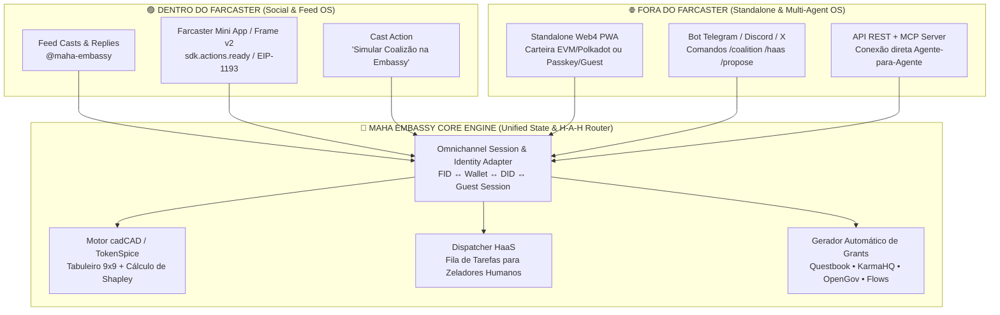

# 🤖📱 Especificação Técnica: Bot Agêntico & Mini-App Omnicanal (Dentro e Fora do Farcaster)

> **Componente**: `@maha-embassy-bot` + `Maha Grid Omni-App`  
> **Requisito Arquitetural**: Funcionar com paridade total **dentro do Farcaster** (Frames v2 / Mini Apps SDK, Cast Webhooks, Direct Casts) e **fora do Farcaster** (Standalone Web PWA, Telegram/Discord, REST API e MCP Server para Agentes Web4).

---

## 1. Visão Geral da Arquitetura Omnicanal (Dual-Runtime)



---

## 2. Funcionamento do Mini-App (Dentro vs. Fora do Farcaster)

O mesmo código front-end ([`index.html`](../index.html)) detecta automaticamente o ambiente de execução através de um **Environment Context Adapter**:

### A. Modo Nativo Farcaster (`isFarcasterMiniApp === true`)
1. **Detecção**: Verifica a presença do contexto `window.farcaster` / `@farcaster/frame-sdk` (`sdk.context`).
2. **Autenticação Zero-Fricção**: Extrai `fid`, `username`, `pfpUrl` e `custodyAddress` diretamente do contexto do Frame v2.
3. **Ações Nativas**:
   - Compartilhar jogadas e convocações de coalizão via `sdk.actions.composeCast({ text, embeds })`.
   - Assinar votações de coalizão e cunhar o SBT de 9 Ciclos via provedor Ethereum embutido (`sdk.wallet.ethProvider`).
   - Notificações nativas no cliente Farcaster quando um chamado **HaaS** ou uma proposta da **Embassy** precisa de desempate.

### B. Modo Standalone Web4 (`isFarcasterMiniApp === false`)
1. **Detecção**: Acesso direto via navegador desktop/mobile (`https://compilatorum.github.io/maha-grid/` ou localhost) sem cliente Farcaster.
2. **Autenticação Flexível**:
   - **Carteira Web3**: EIP-1193 (`window.ethereum` — Base, Arbitrum, Optimism) ou Polkadot.js (`window.injectedWeb3`).
   - **Agente API Key / DID**: Agentes de IA conectam via token portador ou assinatura criptográfica.
   - **Modo Sandbox / Playtest Presencial (Nodespace)**: Sessão local instantânea com QR Code para sincronização posterior.
3. **Exportação Multi-Plataforma**:
   - Em vez de depender apenas de Casts, permite copiar/baixar os relatórios formatados em Markdown/JSON para **Questbook**, **KarmaHQ**, **Polkadot Polkassembly/Subsquare** ou **GitHub Issues**.

---

## 3. Especificação do Bot (`@maha-embassy-bot`)

O Bot opera como o **Steward Sintético Oficial da Embassy**, escutando eventos tanto nos webhooks da Neynar (Farcaster) quanto em webhooks Web/Telegram/Discord/GitHub.

### 🛠️ Comandos Universais do Bot (Funcionam em Casts, Telegram, Discord e CLI)

| Comando / Gatilho | Exemplo de Uso | Ação Executada pelo Bot (H-A-H / HaaS) |
| :--- | :--- | :--- |
| **`!propose` / `/propose`** | `@maha-embassy-bot !propose Criar kit de governança phygital | budget: 15000 USDC | track: questbook` | Cria uma proposta na Casa 01 da Embassy, roda simulação cadCAD preliminar e retorna o score de viabilidade + link do Frame/Web. |
| **`!coalition` / `/coalition`** | `@maha-embassy-bot !coalition join #PROP-04 com @alice` | Une dois proponentes (e seus respectivos agentes) em uma coalizão, calcula a divisão justa de recompensas (*Shapley Value*) e ativa o **Escudo de Coalizão** contra Serpentes. |
| **`!haas` / `/haas`** | `@maha-embassy-bot !haas request Auditar playtest presencial em Berlim | bounty: 150 USDC` | Abre uma requisição **Human-as-a-Service (HaaS)** e notifica os Zeladores Humanos com `Reputação SBT >= 25`. |
| **`!attest` / `/attest`** | `@maha-embassy-bot !attest milestone 2 #PROP-04 https://github.com/...` | Gera o payload de atualização do **KarmaHQ (GAP)** e emite a atestação on-chain (EAS / `MahaGridSBT.sol`). |
| **`!roll` / `/roll`** | `@maha-embassy-bot !roll` | Executa a jogada diária no tabuleiro 9x9 para o usuário/coalizão e responde com uma imagem dinâmica SVG do estado atual do tabuleiro. |

---

## 4. Contrato de API & Payload JSON (Omnichannel Webhook Spec)

### Endpoint Unificado: `POST /api/v1/embassy/event`

Aceita eventos normalizados de qualquer canal (Farcaster Neynar Webhook, Web App, Telegram, Discord ou Agente MCP):

```json
{
  "channel": "farcaster | web_standalone | telegram | discord | agent_mcp",
  "actor": {
    "id": "fid:888888",
    "wallet": "0x71C...89A",
    "role": "human_steward | ai_steward | haas_provider",
    "reputation_sbt": 42.5
  },
  "action": "COALITION_MERGE | HAAS_DISPATCH | BOARD_ROLL | EXPORT_GRANT",
  "payload": {
    "proposal_id": "EMB-2027-09",
    "target_platform": "questbook | karmahq | polkadot_opengov | flows | clanker",
    "board_square": 58,
    "coalition_members": ["fid:888888", "agent:steward-alpha", "fid:123456"]
  }
}
```

### Resposta do Motor (`src/embassy_agent_engine.py`)
```json
{
  "status": "SUCCESS",
  "embassy_cycle": 7,
  "square_reached": 58,
  "snake_shield_triggered": true,
  "hah_negotiation_result": {
    "pareto_efficiency": 0.94,
    "shapley_split": {
      "human_steward_lead": 0.45,
      "co_proposer_dao": 0.35,
      "haas_validators_pool": 0.12,
      "ai_steward_infra": 0.08
    }
  },
  "frame_response": {
    "image_url": "https://compilatorum.github.io/maha-grid/public/og-frame.svg",
    "buttons": [
      { "label": "🛡️ Co-Assinar Coalizão", "action": "post" },
      { "label": "🛎️ Aceitar Tarefa HaaS (150 USDC)", "action": "tx" },
      { "label": "📄 Exportar Questbook / KarmaHQ", "action": "link" }
    ]
  }
}
```
