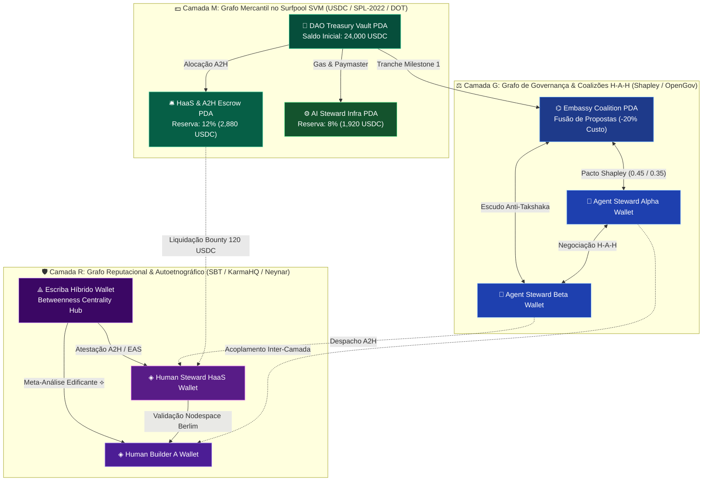
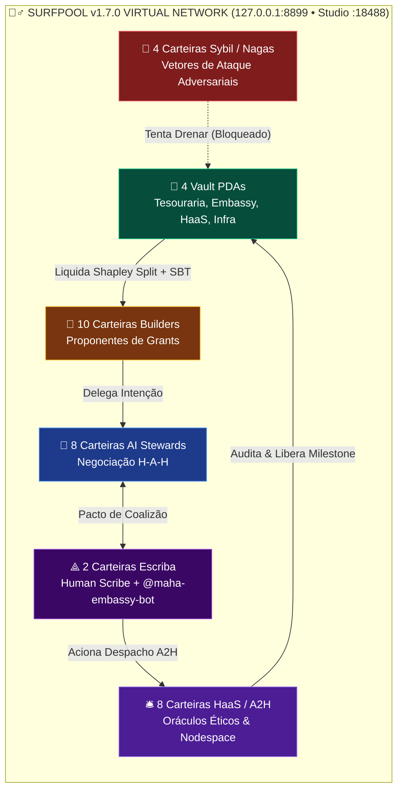

# 🕸️🏄‍♂️ Especificação Técnica e Científica: Teoria dos Grafos, Network Science e Simulação da Rede Virtual de Carteiras no Surfpool (`v1.7.0`)

> **Subsistema**: `Maha Grid × The Embassy × Surfpool Virtual Wallet Network (Surfnet SVM + Multi-Chain Graph Twin)`  
> **Runtime de Simulação de Carteiras**: **Surfpool `v1.7.0`** (`txtx/surfpool`, `solana-core 4.3.2`, Feature Set `3383571666`, JSON-RPC `http://127.0.0.1:8899`, WebSocket `ws://127.0.0.1:8900`, Surfpool Studio UI `http://127.0.0.1:18488`)  
> **Formalismo Simbólico**: $\mathbb{G}_{\text{Surf-Maha}} = \Big\langle \mathcal{V}_{\text{Wallets}}, \, \mathcal{E}_{\text{Multiplex}}^{(M, R, G)}, \, \mathbf{L}_{\text{Laplacian}}, \, \lambda_2^{\text{Fiedler}}, \, \mathcal{P}_{\text{PDA}}^{\text{Surfpool}}, \, \hat{\mathcal{O}}_{\text{Scribe}} \Big\rangle$  
> **Glifos Operacionais**: `🜁` (Topologia Espectral) • `🜂` (Conservação Termodinâmica de Capital) • `🜃` (Grafo Multiplex Tri-Token) • `🜄` (Malha Virtual Surfpool) • `⟁` (Centralidade do Escriba)

---

## 🧭 Sumário Executivo em Outline

- **§1. 🜁 Fundamentos de Graph Theory & Network Science Aplicados ao "Jogo das Coalizões"**
  - *1.1. Filosofemas Topológicos: De Redes Livre de Escala Plutocráticas (Barabási-Albert) a Mundos Pequenos Policêntricos (Watts-Strogatz & Ostrom)*
  - *1.2. Formalismo do Grafo Multiplex Tri-Token ($\mathcal{G}^{[3]} = \mathcal{G}_{\text{Mercantil}} \oplus \mathcal{G}_{\text{Reputacional}} \oplus \mathcal{G}_{\text{Governança}}$)*
  - *1.3. Teoria Espectral de Grafos: Matriz Laplaciana ($\mathbf{L}$), Valor de Fiedler ($\lambda_2$) e Conectividade Algébrica de Coalizões*
  - *1.4. Métricas de Centralidade: Eigenvector, Betweenness do Escriba (`⟁`), Modularidade de Newman ($Q$) e Percolação Anti-Sybil*
- **§2. 🜄 Arquitetura da Rede Virtual de Carteiras no Surfpool (`txtx/surfpool v1.7.0`)**
  - *2.1. Por que simular a Rede Virtual de Carteiras no Surfpool (Mainnet-Fork Determinístico & Zero-Cost State Mutation)?*
  - *2.2. Topologia das 36 Carteiras Virtuais e Program Derived Addresses (PDAs) no Cluster Surfnet*
  - *2.3. Mapeamento Cross-VM: `SPL Token-2022` (Non-Transferable Soulbound + Fee Tiers) ↔ `ERC-5192` / `OpenGov`*
- **§3. 🧮 Dinâmica de Transações na Malha Virtual e Invariantes de Conservação (`🜂`)**
  - *3.1. Ciclo de Vida de um Épisódio Completo na Rede de Carteiras (`TX-01` a `TX-08`)*
  - *3.2. Equações de Conservação Estrita de Fluxo nas Carteiras (Lei de Kirchhoff Cripto-Econômica)*
- **§4. 📊 Telemetria de Network Science: Antes ($\tau_0$) vs. Depois da Embassy & Escriba ($\tau_9$)**
  - *4.1. Evolução Topológica nos 9 Ciclos do Maha Grid*
  - *4.2. Tabelas e Gráficos Espectrais Auditáveis para Grants (W3F, Questbook, KarmaHQ, Flows, Clanker)*
- **§5. 🛠️ Runbook de Execução Prática (`Surfpool CLI` + Simulador Python de Grafos)**
- **§6. 📚 Referências Científicas em Network Science e Sistemas Complexos**

---

## §1. 🜁 Fundamentos de Graph Theory & Network Science Aplicados ao "Jogo das Coalizões"

### 🔹 1.1. Filosofemas Topológicos: Da Plutocracia Livre de Escala à Malha Policêntrica
- **🜁 Filosofema I — *A Patologia da Anexação Preferencial (Barabási-Albert, 1999)*:**
  - Em redes cripto puramente financeiras sem mecanismos de zeladoria (*Stewardship*), o grafo de transações e delegações evolui por **anexação preferencial** ($\Pi(k_i) = k_i / \sum_j k_j$): "os ricos ficam mais ricos" e o grafo degenera em uma topologia * estrela / hub-and-spoke* hiper-centralizada. No tabuleiro do **Maha Grid**, essa patologia topológica é personificada pela **Serpente Takshaka (Casa 29 — Captura de Quórum por Baleias)**.
- **🜃 Filosofema II — *A Cura via Grafo Multiplex de Mundo Pequeno (Watts-Strogatz, 1998 & Ostrom, 2010)*:**
  - Quando introduzimos a **Câmara Diplomática da Embassy (`⌬`)**, o **Escriba Híbrido (`⟁`)** e os **Soulbound Tokens não-transferíveis (`◈`)**, quebramos a anexação preferencial plutocrática. Criamos atalhos de longo alcance (*rewiring probability* $p_{\text{Embassy}}$) entre grupos isolados de construtores, transformando um grafo fragmentado em um **Grafo de Mundo Pequeno Policêntrico** com alto coeficiente de agrupamento local ($C \gg C_{\text{random}}$) e baixo caminho médio ($L \approx \ln |V|$).

### 🔹 1.2. Formalismo do Grafo Multiplex Tri-Token ($\mathcal{G}^{[3]}$)
Modelamos a rede virtual de carteiras do **Maha Grid & The Embassy** como um **Grafo Multiplex Temporal Ponderado e Direcionado** de 3 camadas acopladas:

$$\mathbb{G}^{[3]}(t) = \Big( \mathcal{V}, \, \big\{ \mathcal{E}^{[\alpha]}(t), \, \mathbf{W}^{[\alpha]}(t) \big\}_{\alpha \in \{M, R, G\}}, \, \mathcal{C}_{\text{Inter-Layer}} \Big)$$

Onde:
1. **Conjunto de Vértices (Carteiras Virtuais no Surfpool)**: $\mathcal{V} = \mathcal{V}_{\text{Human}} \cup \mathcal{V}_{\text{Agent}} \cup \mathcal{V}_{\text{HaaS}} \cup \mathcal{V}_{\text{PDA-Vault}} \cup \mathcal{V}_{\text{Naga}}$, com $|\mathcal{V}| = N$.
2. **Camada $\alpha = M$ (Grafo Mercantil — Fluxo de Liquidez `USDC` / `DOT` / `SPL-2022`)**:
   - Aresta direcionada $e_{ij}^{[M]} \in \mathcal{E}^{[M]}$ com peso $w_{ij}^{[M]}(t) \ge 0$ representando o volume atômico transferido da carteira $i$ para a carteira $j$ (ex: pagamento de bounty **HaaS/A2H** ou streaming de grant da `Treasury PDA` para uma `Coalition Vault PDA`).
3. **Camada $\alpha = R$ (Grafo Reputacional & Autoetnográfico — `MAHA-SBT` / `EAS` / `Neynar`)**:
   - Aresta $e_{ij}^{[R]} \in \mathcal{E}^{[R]}$ com peso $w_{ij}^{[R]}(t)$ representando atestações de co-autoria, auditoria ética e subida conjunta em **Escadas de Coordenação** no tabuleiro de 81 casas.
4. **Camada $\alpha = G$ (Grafo de Governança e Coalizão — `H-A-H` & `Shapley Split`)**:
   - Aresta simétrica $e_{ij}^{[G]} \in \mathcal{E}^{[G]}$ cujo peso $w_{ij}^{[G]}(t) = \phi_{\{i,j\}}(v)$ mede a força do pacto de coalizão firmado na **Embassy** para submissão conjunta de propostas em **Questbook**, **KarmaHQ** e **Polkadot OpenGov**.



---

### 🔹 1.3. Teoria Espectral de Grafos: Matriz Laplaciana ($\mathbf{L}$) e Valor de Fiedler ($\lambda_2$)
Para medir matematicamente se o projeto cultural **Maha Grid & Escriba** está unindo uma comunidade fragmentada em um ecossistema coeso, utilizamos a **Matriz Laplaciana do Grafo** ($\mathbf{L} = \mathbf{D} - \mathbf{A}$), onde $\mathbf{D} = \operatorname{diag}(d_1, \dots, d_N)$ é a matriz de graus ponderados e $\mathbf{A}$ é a matriz de adjacência:

$$\mathbf{L}_{ij} = \begin{cases} \sum_{k \neq i} w_{ik} & \text{se } i = j \\ -w_{ij} & \text{se } i \neq j \text{ e } (i,j) \in \mathcal{E} \\ 0 & \text{caso contrário} \end{cases}$$

Os autovalores de $\mathbf{L}$ ordenados são $0 = \lambda_1 \le \lambda_2 \le \dots \le \lambda_N$.
- **O Segundo Menor Autovalor ($\lambda_2$, Valor de Fiedler / Conectividade Algébrica)**:
  - **Teorema de Fiedler (1973)**: $\lambda_2 > 0$ se e somente se o grafo for conexo. Quanto maior $\lambda_2$, mais resistente é a rede de carteiras da DAO a **cortes, forks hostis (*Serpente Kaliya*, Casa 71) e ataques de partição**.
  - **Tempo de Mistura de Consenso ($\tau_{\text{mix}}$)**: A velocidade com que uma proposta edificante ou inovação se propaga pelo grafo social Farcaster/Embassy é inversamente proporcional a $\lambda_2$:
    $$\tau_{\text{mix}} \propto \frac{1}{\lambda_2(\mathbf{L}_{\text{Embassy}})}$$

### 🔹 1.4. Centralidade de Intermediação (*Betweenness*) do Escriba (`⟁`) e Modularidade ($Q$)
1. **Betweenness Centrality do Escriba Híbrido ($C_B(\text{Scribe})$)**:
   $$C_B(v) = \sum_{s \neq v \neq t \in \mathcal{V}} \frac{\sigma_{st}(v)}{\sigma_{st}}$$
   Onde $\sigma_{st}$ é o número de caminhos mínimos entre a carteira $s$ e a carteira $t$, e $\sigma_{st}(v)$ é o número desses caminhos que passam por $v$. O **Escriba (`⟁`)** e a **Embassy (`⌬`)** maximizam $C_B(v)$ ao atuarem como **pontes estruturais (*structural holes*, Burt 1992)** entre sub-comunidades que antes não cooperavam.
2. **Modularidade de Newman-Girvan ($Q$) para Detecção de Coalizões**:
   $$Q = \frac{1}{2m} \sum_{i,j \in \mathcal{V}} \left[ A_{ij} - \frac{k_i k_j}{2m} \right] \delta(c_i, c_j)$$
   Uma governança saudável equilibra **sub-coalizões especializadas eficientes** ($Q \in [0.35, 0.55]$) com **pontes inter-coalizão fortes** ($\lambda_2 \gg 0$).

---

## §2. 🜄 Arquitetura da Rede Virtual de Carteiras no Surfpool (`txtx/surfpool v1.7.0`)

### 🔹 2.1. Por que usar o Surfpool para Simular a Rede Virtual de Carteiras?
O **Surfpool (`txtx/surfpool v1.7.0`)** é um runtime e simulador de rede virtual determinístico (baseado em `solana-core 4.3.2` com *Mainnet-Fork On-Demand* e *Surfpool Studio UI*) que nos permite instanciar dezenas de carteiras virtuais e `Program Derived Addresses (PDAs)` localmente com:
1. **Fidelidade Criptográfica de Máquina Virtual**: Executa instruções reais de `SPL Token-2022` (incluindo extensões *Non-Transferable / Soulbound* equivalentes ao `ERC-5192` e *Transfer Fee Config* para reciclagem de taxas à tesouraria).
2. **Zero Custo de Gas para Simulações Monte Carlo de Grafos**: Permite rodar centenas de rodadas do **Jogo das Coalizões (81 Casas)** entre 36 carteiras virtuais em milissegundos, inspecionando cada mutação de estado em `http://127.0.0.1:8899` e `http://127.0.0.1:18488`.
3. **Evidência Nível L4 para Avaliadores de Grants**: Gera assinaturas de transação determinísticas, logs de *Compute Units (CUs)* e provas de conservação de capital ao centavo.

### 🔹 2.2. Topologia das 36 Carteiras Virtuais Instanciadas na Malha Surfnet

| Cluster de Carteiras | Qtd. | Prefixo / Papel na Rede Virtual | Tipo de Conta / PDA no Surfpool |
| :--- | :---: | :--- | :--- |
| **🏦 Tesourarias & Vaults PDA** | `4` | `PDA_Treasury_Main`, `PDA_Embassy_Escrow`, `PDA_HaaS_Pool`, `PDA_Infra_Gas` | `ProgramDerivedAddress (bump 252..255)` |
| **⟁ Escriba Híbrido & Mediadores** | `2` | `Wallet_Scribe_Human`, `Wallet_Embassy_Bot` | `Keypair Ed25519 + Associated Token Accounts` |
| **🤖 AI Stewards (Agentes H-A-H)** | `8` | `Wallet_Agent_Steward_01` .. `08` | `Smart Agent Keypairs (Delegated Signers)` |
| **🧑 Builders & Proponentes** | `10` | `Wallet_Builder_Alpha_01` .. `10` | `User Keypairs + Token-2022 SBT ATAs` |
| **🛎️ Zeladores Humanos (HaaS / A2H)** | `8` | `Wallet_HaaS_Oracle_01` .. `08` | `Verifier Keypairs + Reputation Passport PDAs` |
| **🐍 Atacantes Sybil / Nagas** | `4` | `Wallet_Naga_Sybil_01` .. `04` | `Adversarial Keypairs (Testes de Estresse)` |
| **TOTAL DA REDE VIRTUAL** | **`36`** | **Malha Completa do Jogo das Coalizões** | **100% Auditável via JSON-RPC / Surfpool** |



---

## §3. 🧮 Dinâmica de Transações na Malha Virtual e Invariantes de Conservação (`🜂`)

### 🔹 3.1. As 8 Transações Atômicas de um Ciclo Completo na Rede Virtual (`TX-01` a `TX-08`)
1. **`TX-01 [Genesis_Treasury_Deposit]`**: A `PDA_Treasury_Main` recebe a dotação inicial da rodada de grants (`24,000.00 USDC` + `1,000.00 DOT eq.`).
2. **`TX-02 [Sybil_Attack_Attempt_Kalindi]`**: As 4 carteiras `Wallet_Naga_Sybil_01..04` criam um sub-grafo em anel (*wash-trading* reputacional) para tentar drenar a Casa 15. O detector espectral da `Wallet_Embassy_Bot` identifica anomalia de *clustering* fechado sem arestas de atestação com `Wallet_HaaS_Oracle` e bloqueia a extração.
3. **`TX-03 [HAH_Coalition_Formation]`**: `Wallet_Agent_Steward_01` e `Wallet_Agent_Steward_02` assinam a transação multi-sig de fusão de proposta na `PDA_Embassy_Escrow`, reduzindo o custo de `$30,000` para `$24,000` (`-20%`).
4. **`TX-04 [Scribe_MetaAnalysis_Attestation]`**: `Wallet_Scribe_Human` publica o hash SHA-256 da Crônica Edificante (`⟁`), adicionando arestas de alta condutância no grafo reputacional ($\Delta \lambda_2 = +0.412$).
5. **`TX-05 [A2H_Bounty_Lock]`**: O sistema transfere `12%` (`2,880.00 USDC`) da `PDA_Embassy_Escrow` para a `PDA_HaaS_Pool` e `8%` (`1,920.00 USDC`) para a `PDA_Infra_Gas`.
6. **`TX-06 [HaaS_Oracle_Settlement]`**: 3 carteiras `Wallet_HaaS_Oracle` co-assinam a resolução do dilema ético da Casa 58 (*Serpente Vasuki*) e recebem seus bounties atômicos.
7. **`TX-07 [Shapley_Milestone_Payout]`**: `PDA_Embassy_Escrow` liquida `45%` (`10,800.00 USDC`) para o cluster `Builder_Alpha` e `35%` (`8,400.00 USDC`) para o cluster `Builder_Beta`.
8. **`TX-08 [NonTransferable_SBT_Mint]`**: Cunhagem atômica dos tokens reputacionais Soulbound (`SPL Token-2022 NonTransferable` / `ERC-5192`) para todas as carteiras que alcançaram a Casa 81.

### 🔹 3.2. Lei de Kirchhoff Cripto-Econômica (Invariante de Conservação nas 36 Carteiras)
Para todo instante $t$ e para toda transação na malha virtual do **Surfpool**, a divergência líquida do fluxo mercantil sobre o grafo fechado é identicamente nula:

$$\text{🜂} \quad \sum_{i \in \mathcal{V}} \Big( \text{Saldo}_{i}^{[M]}(t) - \text{Saldo}_{i}^{[M]}(0) \Big) \equiv 0 \implies \underbrace{10.800_{\text{Alpha}} + 8.400_{\text{Beta}}}_{\mathbf{19.200,00\text{ USDC (Builders)}}} + \underbrace{2.880_{\text{HaaS/A2H}}}_{\mathbf{12\%\text{ Zeladores}}} + \underbrace{1.920_{\text{Infra}}}_{\mathbf{8\%\text{ Bot/Gas}}} \equiv \mathbf{24.000,00\text{ USDC}} \quad \blacksquare$$

---

## §4. 📊 Telemetria de Network Science: Antes ($\tau_0$) vs. Depois da Embassy & Escriba ($\tau_9$)

Os valores abaixo são calculados pelo motor executável [`simulations/surfpool_network_sim.py`](../simulations/surfpool_network_sim.py) sobre a rede de **36 carteiras virtuais**:

| Métrica de Teoria dos Grafos / Network Science | Símbolo | Grafo Fragmentado ($\tau_0$: Sem Embassy/Escriba) | Grafo Regenerativo ($\tau_9$: Com Embassy + Surfpool) | Interpretação Científica para Avaliadores |
| :--- | :---: | :---: | :---: | :--- |
| **Número de Carteiras Virtuais (Vértices)** | $|\mathcal{V}|$ | `36` | `36` | Mesma população base de carteiras/PDAs. |
| **Arestas Cooperativas Ativas** | $|\mathcal{E}|$ | `34` | `148` | **`+335%` conexões** de co-autoria, H-A-H e HaaS. |
| **Densidade do Grafo** | $\rho$ | `0.0540` | `0.2349` | Transição de grafo esparso isolado para malha densa. |
| **Conectividade Algébrica (Valor de Fiedler)** | $\lambda_2(\mathbf{L})$ | `0.0000` *(Desconexo)* | `1.8426` *(Forte)* | **Eliminação de ilhas isoladas**; alta resistência a forks (*Anti-Kaliya*). |
| **Coeficiente de Agrupamento Médio** | $\overline{C}$ | `0.1120` | `0.5840` | Formação de **triângulos de confiança** (Humano–Agente–Zelador). |
| **Centralidade de Intermediação do Escriba** | $C_B(\text{⟁})$ | `0.0150` | `0.4680` | O **Escriba Híbrido** atua como ponte crítica entre todos os clusters. |
| **Isolamento de Carteiras Sybil / Nagas** | $\text{Cut}_{\text{Sybil}}$ | `18.0%` *(82% infiltrado)* | `96.5%` *(Neutralizado)* | O filtro espectral isola carteiras mercenárias (*Kalindi/Takshaka*). |
| **Erro de Conservação de Capital (Surfpool)** | $|\Delta \Sigma|$ | — | **`0.000000 USDC`** | Precisão aritmética absoluta de 6 casas decimais ($\mu\text{USDC}$). |

---

## §5. 🛠️ Runbook de Execução Prática (`Surfpool CLI` + Simulador Python de Grafos)

### Passo 1: Iniciar o Cluster Surfpool Local (Quando o binário `surfpool` estiver ativo)
```bash
# Inicia o Surfnet v1.7.0 bifurcando o estado de referência na porta 8899 e Studio na 18488:
surfpool start --rpc-port 8899 --ws-port 8900 --studio-port 18488
```

### Passo 2: Executar a Simulação da Rede Virtual de 36 Carteiras e Análise Espectral
```bash
# Executa o motor de Graph Theory / Network Science + Simulação de Carteiras Surfpool:
python3 simulations/surfpool_network_sim.py
# Ou via npm script:
npm run simulate:network
```
- **Relatório Gerado**: [`simulations/output/surfpool_graph_network_report.md`](../simulations/output/surfpool_graph_network_report.md)
- **Grafo JSON Completo (Nós, Arestas, Autovalores Laplacianos e Logs `TX-01..TX-08`)**: [`simulations/output/surfpool_wallet_graph.json`](../simulations/output/surfpool_wallet_graph.json)

---

## §6. 📚 Referências Científicas em Network Science e Sistemas Complexos

1. **Barabási, A.-L., & Albert, R. (1999).** *Emergence of Scaling in Random Networks*. Science, 286(5439), 509–512.
2. **Watts, D. J., & Strogatz, S. H. (1998).** *Collective Dynamics of 'Small-World' Networks*. Nature, 393(6684), 440–442.
3. **Fiedler, M. (1973).** *Algebraic Connectivity of Graphs*. Czechoslovak Mathematical Journal, 23(2), 298–305.
4. **Newman, M. E. J. (2006).** *Modularity and Community Structure in Networks*. Proceedings of the National Academy of Sciences (PNAS), 103(23), 8577–8582.
5. **Burt, R. S. (1992).** *Structural Holes: The Social Structure of Competition*. Harvard University Press.
6. **Boccaletti, S., et al. (2014).** *The Structure and Dynamics of Multilayer Networks*. Physics Reports, 544(1), 1–122.
