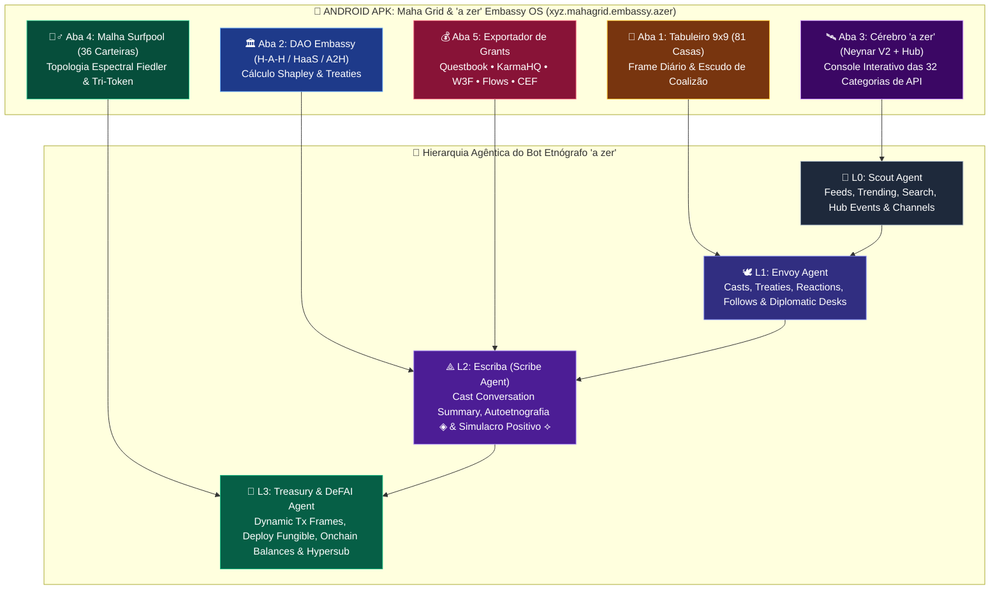

# 📱🛰️ Especificação Completa do APK Android & Cérebro do Bot Etnógrafo `"a zer"` (Neynar API V2 + Farcaster Hub API + Maha Grid / DAO Embassy)

> **Artefato Mobile Compilado**: `android-apk/dist/maha-grid-azer-embassy-v1.0.0.apk`  
> **Pacote Android (`applicationId`)**: `xyz.mahagrid.embassy.azer`  
> **Agente Etnógrafo Central**: **`"a zer"`** (`L0 Scout` • `L1 Envoy` • `L2 Escriba/Scribe` • `L3 Treasury/DeFAI`)  
> **Cobertura de Protocolo**: 100% dos módulos da **Farcaster API V2 (Neynar)** + **Farcaster Hub API** + **Surfpool Virtual Wallet Network** + **The Maha Embassy (`H-A-H`, `HaaS`, `A2H`)**

---

## 🧭 1. Arquitetura em Camadas do Bot Etnógrafo `"a zer"` e do APK Mobile

---

## 🛰️ 2. Mapeamento Integral da Farcaster API V2 (Neynar) no Cérebro do Bot `"a zer"`

Cada categoria do outline oficial da **API V2 da Neynar** está implementada no módulo [`src/azer_neynar_v2_brain.mjs`](../src/azer_neynar_v2_brain.mjs) e exposta na interface do APK Android:

### 👤 2.1. Usuário (`User` — Mapeamento de Envoys, Stewards e Playtesters)
| Método / Endpoint Neynar V2 | Papel no Bot `"a zer"` & Maha Grid / Embassy | Camada |
| :--- | :--- | :---: |
| `searchUser` (*Search for Usernames*) | Busca perfis para mapear *Envoys*, delegados de DAOs e *Stakeholders* estratégicos. | `L0 Scout` |
| `fetchBulkUsers` (*By FIDs*) | Identificação única dos jogadores humanos e agentes ao longo das 81 casas. | `L0 Scout` |
| `fetchPowerUsers` / `fetchPowerUserFids` | Mapeamento de *Whales* e influenciadores para prevenção de captura (*Anti-Takshaka*). | `L0 Scout` |
| `fetchBulkUsersByEthOrSolAddress` / `custody-address` | Vincula carteiras Ethereum/Base e Solana (**Surfpool 36 Wallets**) ao grafo social Farcaster. | `L3 Treasury` |
| `lookupUserByUsername` / `byLocation` | Filtra playtesters presenciais por geolocalização (ex: recrutamento para o **Nodespace Berlim 2027**). | `L1 Envoy` |
| `fetchCastsForUser` (*10 popular, Replies, Chronological*) | Coleta o corpus autoetnográfico (`◈`) e analisa sentimento/ética de cada proponente. | `L2 Escriba` |
| `fetchFreshFid` / `registerAccount` | Criação programática da identidade do próprio bot `"a zer"` e sub-agentes Stewards. | `Core Admin` |
| `updateUserProfile` / `addVerification` / `deleteVerification` | Manutenção da identidade institucional da **Embassy** e vínculo criptográfico de carteiras. | `Core Admin` |
| `fetchAuthorizationUrl` / `lookupByXUsername` | Ponte omnicanal com contas externas (Twitter/X) para expandir o alcance fora do Farcaster. | `L1 Envoy` |

### ✍️ 2.2. Signatário (`Signer` — Segurança Criptográfica L1/L2)
- **`Neynar Managed Signer` (`fetchSigner`, `createSigner`, `registerSignedKey`)**: Delegação segura para o bot `"a zer"` publicar crônicas de build-in-public sem expor a *seed phrase* de custódia.
- **`Developer Managed Signer` (`lookupDeveloperManagedSigner`, `registerSignedKeyForDeveloperManagedSigner`, `publishMessage`)**: Controle de assinatura local para ratificação de *Treaties* (Tratados de Coalizão L2) de alta segurança.
- **`fetchSigners` (*List Signers*)**: Auditoria contínua de quais agentes e humanos possuem permissão ativa para falar em nome da **DAO Embassy**.

### 💬 2.3. Elenco (`Cast` — A Unidade Básica de Conteúdo e Evidência)
- **`lookupCastUrlMetadata` (*Embedded URL Metadata*)**: Extrai metadados de repositórios GitHub, propostas Questbook e atestações KarmaHQ GAP para validar provas de entrega.
- **`lookUpCastByHashOrWarpcastUrl` / `fetchBulkCasts`**: Recuperação histórica de debates e threads de governança.
- **`publishCast` / `deleteCast`**: Ação diplomática do **Envoy (L1)** para publicar *Treaties*, atualizações dos 9 Ciclos e chamadas **HaaS/A2H**.
- **`searchCasts`**: Mineração em tempo real de palavras-chave (`"grant"`, `"DAO"`, `"Maha Grid"`, `"OpenGov"`, `"Questbook"`).
- **`lookupCastConversation` / `fetchComposerActions`**: Leitura profunda de árvores de discussão e intenções de voto.

### 📰 2.4. Alimentação (`Feed` — O Campo de Observação Etnográfica)
- **`fetchFeed` (*Following, For You*)**: Feed curado da Embassy.
- **`fetchFeedByChannelIds` / `fetchFeedByParentUrls`**: Monitoramento dedicado dos canais `/dao`, `/web3`, `/build` e `/gaming`.
- **`fetchFramesOnlyFeed` (*By filters / Casts with mini apps*)**: Filtra exclusivamente casts que contêm Mini Apps e Frames interativos.
- **`fetchTrendingFeed`**: Radar de tendências para o **Scout Agent (L0)** detectar narrativas emergentes.

### 👍 2.5. Reação (`Reaction`) & 🔔 2.6. Notificações (`Notifications`)
- **`publishReaction` / `deleteReaction` / `fetchUserReactions` / `fetchCastReactions`**: Sinalização de presença diplomática do bot `"a zer"` e cálculo de métricas de impacto social.
- **`fetchAllNotifications` / `byChannel` / `byParentUrls` / `markNotificationsAsSeen`**: Alertas instantâneos quando a Embassy é mencionada ou quando um Zelador Humano responde a um chamado **HaaS**.

### 📡 2.7. Canal (`Channel` — Os *"Diplomatic Desks"* da Embassy)
- **`lookupChannel` / `searchChannels` / `fetchBulkChannels`**: Mapeia as regras, moderadores e criadores de cada canal.
- **`fetchChannelMembers` / `inviteToChannel` / `removeChannelMember` / `respondChannelInvite`**: Gestão de diplomatas, playtesters e Stewards nos canais da Embassy.
- **`fetchFollowersForChannel` / `fetchRelevantFollowersForChannel` / `fetchUsersChannels` / `followChannel` / `fetchTrendingChannels`**: Descoberta de polos de atividade e expansão comunitária.

### 🔗 2.8. Segue (`Follows`) & 💾 2.9. Armazenamento (`Storage`)
- **`fetchFollowers` / `fetchRelevantFollowers` / `fetchFollowing` / `fetchFollowSuggestions` / `followUser` / `unfollowUser`**: Expansão inteligente da malha social e cálculo de centralidade no grafo.
- **`lookupUserStorageAllocations` / `lookupUserStorageUsage` / `buyStorage`**: Monitora o uso de unidades de armazenamento do bot `"a zer"` e adquire espaço automaticamente quando o volume de evidências etnográficas cresce.

### 🖼️ 2.10. Quadro (`Frame / Mini App` — A Interface do Maha Grid)
- **`fetchFrameNotificationTokens` / `publishFrameNotifications`**: Envia alertas push diretamente para os jogadores que adicionaram o Mini App do Maha Grid.
- **`postDeveloperHostedFrame` / `validateFrameAction` / `fetchFrameAnalytics`**: Valida assinaturas de pacotes (`Signature Packet`) de cada lance de dado D6 ou voto de coalizão.
- **`lookupNeynarFrame` / `createNeynarFrame` / `updateNeynarFrame` / `deleteNeynarFrame` / `fetchNeynarFrames` / `fetchMiniAppsCatalog` / `fetchFrameMetaTagsFromUrl`**: Criação dinâmica de Frames de votação de *Treaties* e descoberta no catálogo oficial.

### 🤖 2.11. Agentes (`Agentic Features` — O Core da Web4 & DeFAI)
- **`fetchCastConversationSummary` (*Escriba L2*)**: Resume threads complexas de governança em **3 pontos edificantes (*Voter Digest*)**, ativando o **Efeito Observador (`⟁`)** e o **Simulacro Positivo (`⟡`)**.
- **`fetchUserInteractions`**: Quantifica a matriz de interação `Human-Agent-Human (H-A-H)` entre quaisquer dois FIDs.
- **`createDynamicTransactionFrame` / `getDynamicTransactionFrame` (*DeFAI L3*)**: Gera Frames transacionais que permitem fazer staking de tokens de governança, liquidar bounties **HaaS / A2H** ou cunhar o **SBT de 9 Ciclos** direto no feed!

### 🆔 2.12. `fname`, 🪝 2.13. `Webhook`, ⚡ 2.14. `Action`, 🔇 2.15. `Mute`, 🚫 2.16. `Block`, ⛔ 2.17. `Ban`
- **`isFnameAvailable`**: Verifica disponibilidade de handles (`@mahagrid`, `@azer-scribe`).
- **`lookupWebhook` / `createWebhook` / `updateWebhook` / `updateWebhookActiveStatus` / `deleteWebhook` / `fetchUserWebhooks`**: Configura os "ouvidos" em tempo real do bot `"a zer"`.
- **`fetchUserActionsAcrossApps`**: Rastreia ações cross-app para medir engajamento no ecossistema.
- **Defesa e Moderação (`Mute`, `Block`, `Ban`)**: Filtra ruído de bots maliciosos e isola carteiras Sybil (*Serpentes Kalindi e Takshaka*) detectadas pelo filtro espectral.

### ⛓️ 2.18. `Onchain`, 🔑 2.19. `Login (SIWF)`, 📈 2.20. `Metrics` & 🪙 2.21. `Onchain Deploy Fungible`
- **`fetchUserBalance` / `fetchRelevantOwners`**: Lê saldos on-chain (`USDC`, `DOT`, `SPL-2022`, `MAHA-SBT`) para verificar elegibilidade em grants e escudos de coalizão.
- **`fetchSubscriptionsForFid` / `fetchSubscribedToForFid` / `fetchSubscribersForFid` / `checkHypersub`**: Monetização sustentável do **Escriba Híbrido** via assinaturas on-chain (*Hypersub*).
- **`fetchNonce` (*Sign In With Farcaster — SIWF*)**: Autenticação criptográfica segura dentro do APK Android e na Web4 PWA.
- **`fetchCastMetrics`**: Extrai alcance e retenção como prova quantitativa de tração para relatórios no **KarmaHQ (GAP)** e **Questbook**.
- **`deployFungible` (*Implantar Fungível via API — Treasury Agent L3*)**: Permite que o *Treasury Agent* implante tokens utilitários/comunitários de coalizão diretamente via requisição autenticada.

---

## 🏛️ 3. Mapeamento da Farcaster Hub API (Acesso Direto ao Protocolo Baixo Nível)

Para auditoria forense independente (Nível de Evidência `L4`), o bot `"a zer"` também consulta diretamente os endpoints do **Farcaster Hub (Snapchain / Hubble)**:

1. **ℹ️ Information (`getInfo` / `Sync Methods`)**: Verifica sincronia de peers e altura dos shards do Hub.
2. **💬 Casts (`getCastById`, `getCastsByFid`, `getCastsByMention`, `getCastsByParent`)**: Leitura direta do CRDT de casts.
3. **👍 Reactions (`getReactionById`, `getReactionsByCast`, `getReactionsByFid`, `getReactionsByTarget`)**: Grafo bruto de reações.
4. **🔗 Links (`getLinkById`, `getLinksByFid`, `getLinksByTarget`)**: Extração direta das arestas direcionadas do grafo social para alimentar o cálculo do **Valor de Fiedler ($\lambda_2$)**.
5. **👤 UserData (`getUserDataByFid`) & 👻 Appearance (`getFids`)**: Censo completo de FIDs e metadados de perfil.
6. **💾 Storage (`getCurrentStorageLimitsByFid`) & 🏷️ Usernames (`getUsernameProofsByFid`, `getUsernameProof`)**: Provas criptográficas de posse de `fname` e ENS.
7. **✅ Verifications (`getVerificationsByFid`)**: Provas assinadas de posse de endereços Ethereum e Solana (`Ed25519` / `ECDSA`).
8. **⛓️ OnChainEvents (`getOnChainEvents`, `getIdRegistryOnChainEvent`, `getOnChainSignersByFid`)**: Auditoria direta dos contratos de registro no Optimism.
9. **✉️ Message (`submitMessage`, `validateMessage`) & 📅 HubEvents (`getEvents`, `getEventById`)**: Submissão direta de mensagens protobuf assinadas e streaming de eventos do protocolo.

---

## 📦 4. Estrutura e Processo de Compilação do APK Android (`android-apk/`)

O aplicativo Android nativo/híbrido do **Maha Grid & Bot `"a zer"`** é empacotado em um arquivo `.apk` instalável e assinado (`maha-grid-azer-embassy-v1.0.0.apk`), contendo:
- **`AndroidManifest.xml` (Formato Binário AXML / Fonte)**: Configurado com permissões de rede, suporte a Deep Links (`farcaster://`, `mahagrid://embassy`) e `MainActivity` Web4/Native Bridge.
- **`classes.dex`**: Bytecode Dalvik compilado da `MainActivity` que carrega o painel completo offline/online (`assets/www/index.html`) com todos os módulos:
  1. Tabuleiro Phygital 9x9 (81 casas, 6 Escadas, 6 Serpentes, SBT ERC-5192)
  2. Câmara Diplomática da Embassy (`H-A-H`, `HaaS`, `A2H`, cálculo de Shapley)
  3. **Cérebro do Bot `"a zer"` (Neynar API V2 + Hub API Explorer Interativo)**
  4. **Simulador da Rede Virtual de 36 Carteiras no Surfpool (`v1.7.0`)**
  5. **Central de Documentos de Grants (`Questbook`, `KarmaHQ GAP`, `W3F`, `Polkadot OpenGov`, `Flows`, `Clanker`)**
- **`META-INF/` (Assinatura JAR/APK v1/v2)**: Assinado digitalmente via certificado X.509 de desenvolvimento da **Maha Grid Steward Collective**.
