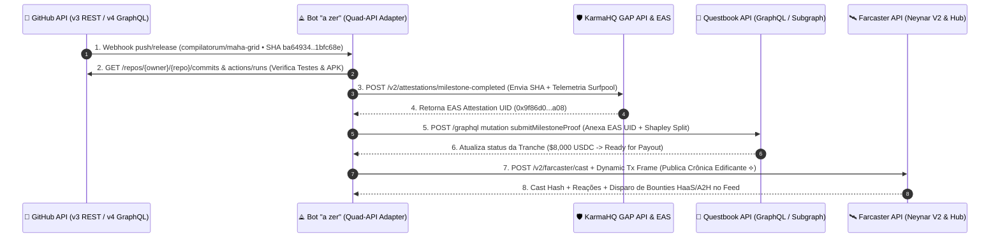
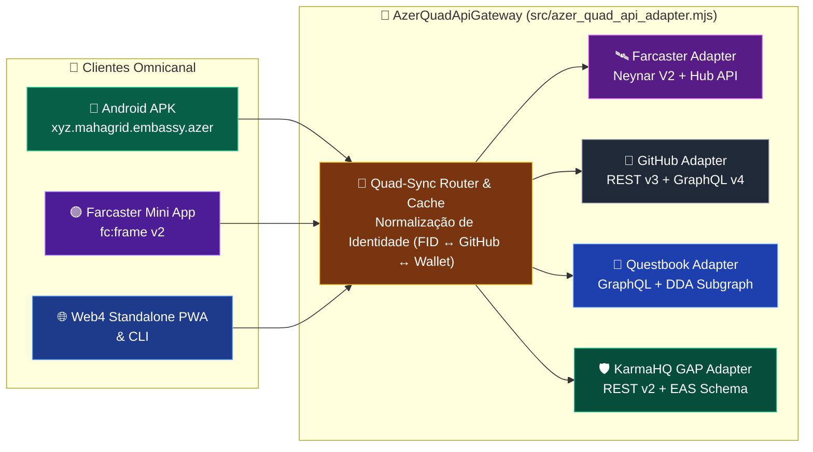

# 🔌🌐 Especificação da Arquitetura Quad-API: Farcaster (Neynar V2 / Hub) × GitHub × Questbook × KarmaHQ (GAP)

> **Subsistema**: `AzerQuadApiGateway` (`src/azer_quad_api_adapter.mjs`)  
> **Escopo**: Integração bidirecional das **4 APIs Críticas de Governança e Build-in-Public** para o bot etnógrafo **`"a zer"`**, o **Maha Grid (9 Ciclos)**, a **DAO Embassy (`H-A-H`, `HaaS`, `A2H`)** e o **APK Mobile (`xyz.mahagrid.embassy.azer`)**  
> **Formalismo Simbólico**: $\mathcal{A}_{\text{Quad}} = \mathcal{F}_{\text{Farcaster}} \bowtie \mathcal{G}_{\text{GitHub}} \bowtie \mathcal{Q}_{\text{Questbook}} \bowtie \mathcal{K}_{\text{KarmaHQ}}$  
> **Glifos de Sincronização**: `🛰️` (Farcaster/Neynar) • `🐙` (GitHub Proof-of-Code) • `📘` (Questbook Grants) • `🛡️` (KarmaHQ Accountability) • `⟁` (Escriba Orquestrador)

---

## 🧭 Sumário Executivo em Outline

- **§1. 🌌 Visão Geral da Malha Quad-API e o Loop Cibernético do Escriba (`⟁`)**
  - *1.1. Rationale: Por que unificar Farcaster, GitHub, Questbook e KarmaHQ em uma única API?*
  - *1.2. Diagrama Mermaid: Pipeline Quad-Sync (Do Commit no GitHub à Liquidação de Grant e Frame no Farcaster)*
- **§2. 🛰️ Adaptador 1: Farcaster API (`Neynar V2 REST` + `Farcaster Hub HTTP/gRPC`)**
  - *2.1. Endpoints Mapeados, Headers de Autenticação e Webhooks*
  - *2.2. Contratos de Dados para Autoetnografia (`◈`), Treaties (`H-A-H`) e Dynamic Tx Frames (`DeFAI`)*
- **§3. 🐙 Adaptador 2: GitHub API (`REST v3` + `GraphQL v4` + `Actions Artifacts`)**
  - *3.1. Verificação Criptográfica de Entregáveis Técnicos (`Commits`, `PRs`, `Releases`, `CI Tests`)*
  - *3.2. Uso de GitHub Issues/Discussions como Espelho Fora do Farcaster para a DAO Embassy*
- **§4. 📘 Adaptador 3: Questbook API (`GraphQL Gateway` + `Subgraph DDA` + `On-Chain Rubrics`)**
  - *4.1. Descoberta de Tracks/Pools, Submissão de Propostas de Coalizão e Rubricas AI Steward*
  - *4.2. Mutação de Milestones e Gatilho de Desembolso Multi-Sig (`Shapley Split`)*
- **§5. 🛡️ Adaptador 4: KarmaHQ GAP API (`REST v2` + `EAS On-Chain Attestations`)**
  - *5.1. Sincronização de Perfil de Grantee, Milestones e Métricas de Impacto (`Surfpool` + `cadCAD`)*
  - *5.2. Endossos Cruzados H-A-H / HaaS e Atestações `ERC-5192` (`MahaGridSBT.sol`)*
- **§6. 🔄 Especificação da API Unificada da Embassy (REST / MCP / APK Bridge)**

---

## §1. 🌌 Visão Geral da Malha Quad-API e o Loop Cibernético do Escriba (`⟁`)

### 🔹 1.1. Rationale: A Eliminação do Abismo entre Código, Narrativa, Financiamento e Reputação
Em projetos Web3 convencionais, as quatro dimensões fundamentais de um bem público vivem isoladas:
1. O **código e as simulações** vivem no **GitHub** (`🐙`), invisíveis para a comunidade social.
2. A **narrativa e o engajamento** vivem no **Farcaster** (`🛰️`), muitas vezes desconectados de provas técnicas verificáveis.
3. O **pedido de financiamento** vive no **Questbook** (`📘`), exigindo preenchimento manual repetitivo.
4. A **prestação de contas pós-grant** vive no **KarmaHQ GAP** (`🛡️`), frequentemente esquecida após o recebimento dos fundos.

O **Adaptador Quad-API do Bot `"a zer"`** ([`src/azer_quad_api_adapter.mjs`](../src/azer_quad_api_adapter.mjs)) transforma essas 4 plataformas em **um único barramento de estado determinístico**:

$$\text{⟁} \quad \operatorname{Commit}_{\text{GitHub}}(\Delta \text{Code}) \xrightarrow{\text{SHA-256}} \operatorname{Attest}_{\text{KarmaHQ}}(\text{GAP}) \xrightarrow{\text{EAS UID}} \operatorname{Claim}_{\text{Questbook}}(\text{Milestone}) \xrightarrow{\text{Tx Hash}} \operatorname{Cast}_{\text{Farcaster}}(\text{Frame v2} \oplus \text{SBT})$$

### 🔹 1.2. Diagrama Mermaid: O Pipeline de Sincronização Quad-API (`Quad-Sync Loop`)



---

## §2. 🛰️ Adaptador 1: Farcaster API (`Neynar V2 REST` + `Farcaster Hub API`)

- **Base URLs**:
  - **Neynar V2 REST**: `https://api.neynar.com/v2/farcaster`
  - **Farcaster Hub HTTP API**: `https://hub-api.neynar.com/v1` (ou nó Hubble/Snapchain local `:2281/v1`)
- **Headers**: `x-api-key: $NEYNAR_API_KEY`, `x-neynar-experimental: true`, `Content-Type: application/json`

| Operação no Ecossistema Maha Grid | Endpoint Farcaster (Neynar V2 / Hub) | Método | Papel na Integração Quad-API |
| :--- | :--- | :---: | :--- |
| **Perfil Autoetnográfico (`◈`)** | `/user/bulk?fids={fids}` & `/feed/user/casts?fid={fid}` | `GET` | Extrai biografia, carteiras verificadas (EVM/Solana) e histórico de casts para vincular ao perfil do GitHub e KarmaHQ. |
| **Extração de Provas de Link** | `/cast/embed-metadata?url={github_or_karmahq_url}` | `GET` | Valida links do GitHub, Questbook e KarmaHQ antes de indexar uma evidência de Milestone. |
| **Publicação de Crônica & Frame** | `/cast` (com `signer_uuid`, `embeds`, `channel_id`) | `POST` | Publica atualizações automáticas a cada milestone aprovado no Questbook ou atestado no KarmaHQ. |
| **Resumo Agêntico de Thread (`⟁`)** | `/cast/conversation/summary?identifier={hash}` | `GET` | Gera o *Voter Digest* de 3 pontos para anexar nas propostas do Questbook. |
| **Frame Transacional DeFAI (`L3`)** | `/frame/transaction` | `POST` | Permite que avaliadores ou Zeladores Humanos assinem transações (bounties HaaS / mint SBT) direto no feed. |
| **Auditoria Direta no Hub (`L4`)** | `/v1/verificationsByFid` & `/v1/linksByFid` | `GET` | Confirma criptograficamente a posse das carteiras e extrai as arestas do grafo social. |

---

## §3. 🐙 Adaptador 2: GitHub API (`REST v3` + `GraphQL v4`)

- **Base URLs**:
  - **REST v3**: `https://api.github.com`
  - **GraphQL v4**: `https://api.github.com/graphql`
- **Headers**: `Authorization: Bearer $GITHUB_TOKEN`, `Accept: application/vnd.github+json`, `X-GitHub-Api-Version: 2022-11-28`

| Operação no Ecossistema Maha Grid | Endpoint GitHub API | Método | Papel na Integração Quad-API |
| :--- | :--- | :---: | :--- |
| **Inspeção do Repositório & Metadados** | `/repos/compilatorum/maha-grid` | `GET` | Verifica licença aberta (`MIT`/`CC0`), estrelas, forks e status do repositório para o Questbook e KarmaHQ. |
| **Auditoria de Commits & Provas `L4`** | `/repos/{owner}/{repo}/commits/{sha}` | `GET` | Extrai hash criptográfico do commit, autor, diff de simulações (`maha_grid_sim.py`, `surfpool_network_sim.py`) e carimbo de tempo. |
| **Espelho da Embassy (Issues / PRs)** | `/repos/{owner}/{repo}/issues` & `/pulls` | `POST / GET` | Cria e sincroniza propostas de coalizão **H-A-H** e chamados **HaaS / A2H** para construtores que operam fora do Farcaster. |
| **Publicação de Releases & APK** | `/repos/{owner}/{repo}/releases` | `POST` | Publica releases oficiais anexando o binário `maha-grid-azer-embassy-v1.0.0.apk` e os relatórios de simulação. |
| **GraphQL Contributors & Shapley** | `POST /graphql` (`repository.defaultBranchRef.target.history`) | `POST` | Calcula a contribuição técnica real de cada facção para calibrar automaticamente o **Valor de Shapley ($\phi_i$)**. |

---

## §4. 📘 Adaptador 3: Questbook API (`GraphQL Gateway` & `Subgraph DDA`)

- **Base URLs**:
  - **Questbook Core GraphQL**: `https://api.questbook.app/graphql`
  - **Questbook Subgraph (Polygon / Arbitrum / Optimism)**: `https://api.thegraph.com/subgraphs/name/questbook/grants-polygon` (e endpoints descentralizados equivalentes)

### 🔹 Queries & Mutations Implementadas no Adaptador (`QuestbookApiAdapter`)

1. **`queryFetchGrantWorkspacesAndTracks`**:
   - Lista programas ativos de *Delegated Domain Allocators (DDA)* (ex: *Developer Tooling*, *Governance & Simulation*, *New Protocols*) compatíveis com o Maha Grid.
2. **`mutationCreateCoalitionGrantApplication`**:
   - Submete automaticamente a proposta negociada na **Embassy (`EMB-COALITION-2027-01`)**, preenchendo título, resumo de 3 pontos (*Voter Digest*), link do repositório GitHub, link do perfil KarmaHQ GAP e os 3 Milestones com divisão de Shapley (`$8k / $9k / $7k = $24,000 USDC`).
3. **`mutationSubmitMilestoneUpdate`**:
   - Quando o adaptador do **GitHub** confirma que os testes unitários e a simulação Surfpool passaram, envia automaticamente a prova de conclusão do Milestone para o Domain Allocator do Questbook liberar o pagamento na carteira multi-sig / `PDA_Embassy_Escrow`.

```graphql
mutation SubmitEmbassyMilestoneToQuestbook($applicationId: ID!, $milestoneId: ID!, $proofData: MilestoneProofInput!) {
  submitMilestone(input: {
    applicationId: $applicationId,
    milestoneId: $milestoneId,
    proofOfWorkUrl: $proofData.githubCommitUrl,
    karmahqAttestationUid: $proofData.easAttestationUid,
    farcasterCastHash: $proofData.scribeCastHash,
    summary: $proofData.edifyingSummary
  }) {
    id
    status
    payoutTxHash
  }
}
```

---

## §5. 🛡️ Adaptador 4: KarmaHQ GAP API (`REST v2` + `EAS On-Chain Attestations`)

- **Base URLs**:
  - **KarmaHQ GAP API**: `https://gapapi.karmahq.xyz`
  - **Indexer / Attestation Explorer**: `https://gap.karmahq.xyz/api`
- **Contrato / Padrão On-Chain**: Ethereum Attestation Service (`EAS`) nos esquemas oficiais do *Grantee Accountability Protocol (GAP)* + vinculação direta com [`contracts/MahaGridSBT.sol`](../contracts/MahaGridSBT.sol) (`ERC-5192`).

| Operação de Accountability | Endpoint KarmaHQ GAP API / EAS | Método | Payload Sincronizado pelo Bot `"a zer"` |
| :--- | :--- | :---: | :--- |
| **Registro/Leitura do Projeto** | `/projects/maha-grid-embassy-web4` | `GET / PUT` | Sincroniza metadados do projeto, membros da coalizão (FIDs Farcaster + Handles GitHub) e carteiras. |
| **Vinculação de Grant Track** | `/grants` | `POST` | Registra os grants pleiteados/aprovados no **Questbook**, **Web3 Foundation**, **Polkadot OpenGov**, **Flows** e **Clanker**. |
| **Atestação de Milestone (`GAP`)** | `/milestones/{milestoneUID}/attest` | `POST` | Envia o bundle de telemetria (`telemetry.json` + `surfpool_wallet_graph.json` + commit SHA do GitHub) assinado pelo AI Steward e pelo Human Steward (**HaaS**). |
| **Endosso de Steward (`H-A-H` / `A2H`)** | `/projects/{projectUID}/endorsements` | `POST` | Registra o parecer técnico e ético do **Escriba Híbrido (`⟁`)** e dos Oráculos Humanos que validaram os playtests no *Nodespace Berlim*. |

---

## §6. 🔄 Diagrama de Arquitetura Integrada: O Barramento Quad-API no APK e no Servidor


