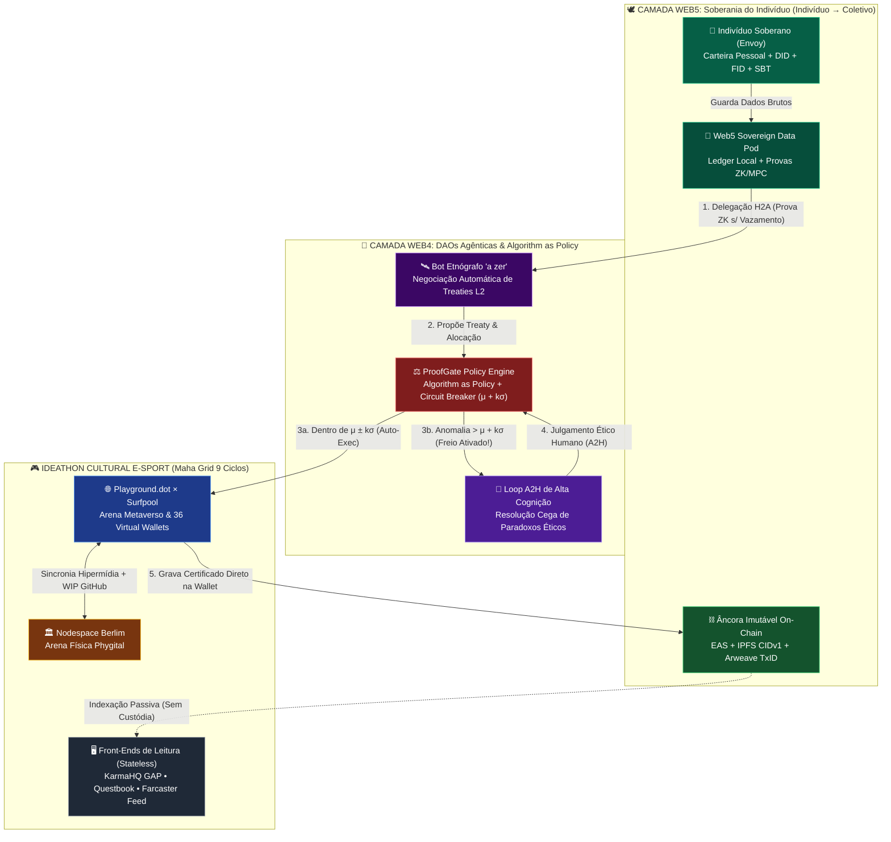

# 🌐🛡️ Arquitetura de Hipercoordenação Web4 & Web5: `Algorithm as Policy` (`ProofGate`), Soberania do Indivíduo, Ideathon E-sport (`Playground.dot`) e Mitigação das 5 Lacunas Críticas

> **Paradigma**: `Web4 (Web Agêntica: Algorithm as Policy)` $\otimes$ `Web5 (Web Soberana e Individual: Indivíduo → Coletivo)`  
> **Motor de Política e Segurança**: **`ProofGate Policy Engine`** + **Bot Etnógrafo `"a zer"`** + **Arena `Playground.dot` × `Nodespace Berlim`**  
> **Formalismo Simbólico**: $\mathbb{H}_{\text{Web4/5}} = \Big\langle \mathcal{I}_{\text{Web5}}^{\text{DID/SBT}}, \, \mathcal{P}_{\text{ProofGate}}^{\mu \pm k\sigma}, \, \Psi_{\text{A2H}}^{\text{Cognitivo}}, \, \Pi_{\text{ZK/MPC}}, \, \mathcal{E}_{\text{E-sport}}^{\text{WIP}}, \, \mathcal{L}_{\text{Perma}}^{\text{EAS+IPFS+Arweave}} \Big\rangle$  
> **Glifos de Hipercoordenação**: `🕊️` (Soberania Web5) • `⚖️` (ProofGate Policy Engine) • `🛑` (Circuit Breaker $\mu+k\sigma$) • `🔐` (ZK/MPC Privacy) • `🎮` (Builder E-sport) • `⛓️` (Perma-Ledger Imutável)

---

## 🧭 Sumário Executivo em Outline

- **§1. 🌐 A Transição para Web4 & Web5: Do Coletivo Burocrático ao Ecossistema de Hipercoordenação**
  - *1.1. DAOs Agênticas e a Fusão de `"Code is Law"` com `"Algorithm as Policy"` (`ProofGate`)*
  - *1.2. A Inversão Ontológica da Web5 (`Indivíduo → Coletivo`, `H2A` e `A2H` Soberano)*
  - *1.3. O Ledger Coletivo Descentralizado e a Evolução do Maha Grid para Ideathon E-sport (`Playground.dot` + `Nodespace` + `Farcaster`)*
- **§2. ⚠️ Metacrítica Arquitetural: Diagnóstico Formal das 5 Lacunas (Gaps) de Risco Sistêmico**
  - *2.1. Lacuna 1: O Paradoxo `"Code is Law"` vs. `"Algorithm as Policy"` (Alucinação, Drift e Drenagem)*
  - *2.2. Lacuna 2: `A2H` como "Carimbo Humano" (*Rubber Stamping* e Câmaras de Eco Algorítmicas)*
  - *2.3. Lacuna 3: O Gargalo da Web5 (Soberania Local de Dados vs. Etnografia em Tempo Real)*
  - *2.4. Lacuna 4: Gamificação E-sport vs. Seriedade na Alocação de Recursos (Plutocracia de Gamers/Mercenários)*
  - *2.5. Lacuna 5: A Ilusão da Descentralização do Ledger (Dependência de SaaS: KarmaHQ e Questbook)*
- **§3. 🛡️ Engenharia de Mitigação: Os 5 Mecanismos Antifrágil Implementados no Código**
  - *3.1. Mitigação 1 (`ProofGate Statistical Circuit Breaker`): Freio de Emergência $\mu + k\sigma$ em Tempo Real*
  - *3.2. Mitigação 2 (`High-Cognition Blind A2H`): Resolução Cega de Paradoxos Éticos Contra Rubber Stamping*
  - *3.3. Mitigação 3 (`Web5 ZK-Pod & Pedersen Commitments`): Etnografia e Coalizões sem Expor Dados Privados*
  - *3.4. Mitigação 4 (`WIP-Gated Builder E-sport`): Jogadas Condicionadas a Provas Reais de Trabalho (GitHub/Farcaster)*
  - *3.5. Mitigação 5 (`Sovereign Perma-Anchor`): Carteira Nativa (`EAS` + `ERC-5192`) + `IPFS` + `Arweave` (KarmaHQ/Questbook como Read-Views)*

---

## §1. 🌐 A Transição para Web4 & Web5: Do Coletivo Burocrático ao Ecossistema de Hipercoordenação

### 🔹 1.1. DAOs Agênticas & `"Algorithm as Policy"` (`ProofGate`)
Na governança Web3 clássica, *"Code is Law"* governa apenas a liquidação estática (contratos inteligentes rígidos), enquanto a política depende de votações humanas lentas sujeitas a 72% de abstenção (*Serpente Karkotaka*).
- Na **Web4 Agêntica**, a **DAO Embassy** substitui a burocracia lenta pelo **`ProofGate` (Policy Engine)** atuando como ***"Algorithm as Policy"***.
- O bot etnógrafo **`"a zer"` (Envoy Agent)** lê continuamente o grafo social Farcaster, negocia *Treaties* (Tratados de Coalizão) e aloca micro-recursos programaticamente na camada `L2`, dentro de bandas matemáticas estritas, sem exigir micro-votações humanas para rotinas operacionais.

### 🔹 1.2. Web5 (`Indivíduo → Coletivo`): Soberania Pessoal e Duplo Fluxo `H2A ⇄ A2H`
A **Web5** inverte o vetor de autoridade das DAOs tradicionais:
1. **Ancoragem Soberana Individual (`🕊️`)**: O participante (*Envoy*) não "pertence" a uma DAO; ele ingressa com sua própria identidade e **Ledger Soberano Pessoal** (`DID` + `Farcaster FID` + `SBTs` em sua carteira).
2. **Delegação `H2A` (*Human-to-Agent*)**: O indivíduo opta livremente por conectar seu *Pod Web5* a uma **Embassy (Guilda/Coletivo)** e delega sua representação diplomática ao seu agente (`"a zer"` / `AI Steward`).
3. **Retorno e Auditoria `A2H` (*Agent-to-Human*)**: O registro final de suas contribuições, direitos autorais (`CC0`/`MIT`) e participação nos *Shapley Splits* retorna e permanece criptograficamente ancorado na **carteira individual soberana do humano**, jamais aprisionado em um servidor coletivo.

### 🔹 1.3. Ideathon Cultural como E-sport / RPG Metaverso (`Nodespace` × `Playground.dot` × `Farcaster`)
O **Maha Grid (9 Ciclos / 81 Casas)** evolui de um tabuleiro estático para uma **Arena de E-sport de Construtores (Ideathon Cultural)**:
- **Guildas (Embassies)** competem e cooperam simultaneamente em três planos sincronizados:
  1. **Plano Físico**: Mesas táticas presenciais no **Nodespace (Web3 Summit Berlim 2027)**.
  2. **Plano Metaverso / Simulação**: Ambiente interativo **`Playground.dot`** + malha virtual de **36 carteiras no Surfpool**.
  3. **Plano Hipermídia Social**: Transmissão em tempo real de jogadas, *Treaties* e resumos edificantes via **Frames v2 no Farcaster**.

---

## §2. ⚠️ Metacrítica Arquitetural & §3. 🛡️ Engenharia de Mitigação das 5 Lacunas Críticas

A tabela abaixo sintetiza como cada uma das **5 Lacunas Críticas** apontadas na metacrítica foi convertida em um mecanismo formal verificável no motor [`src/web5_proofgate_hypercoordination.py`](../src/web5_proofgate_hypercoordination.py) e no contrato [`contracts/MahaGridSBT.sol`](../contracts/MahaGridSBT.sol):

| Lacuna Identificada na Metacrítica | Risco de Colapso se Não Mitigado | Mecanismo Técnico de Mitigação Implementado | Equação / Regra de Invariância no Código |
| :--- | :--- | :--- | :--- |
| **🕳️ Lacuna 1**: `"Code is Law"` vs. `"Algorithm as Policy"` | Alucinação ou *prompt drift* do LLM drenar a tesouraria irreversivelmente. | **🛑 `ProofGate Circuit Breaker Estatístico`**: Trava qualquer alocação cujo Z-score exceda $k\sigma$ da média móvel histórica ou que apresente divergência entre agentes. | $$Z = \frac{|x - \mu_{\text{hist}}|}{\sigma_{\text{hist}}} > k_{\max} \implies \mathtt{HALT\_TO\_A2H}$$ |
| **🕳️ Lacuna 2**: `A2H` como "Carimbo Humano" (*Rubber Stamping*) | Humano vira aprovador passivo de câmaras de eco algorítmicas, destruindo a Web5. | **🧠 `Protocolo A2H de Alta Cognição (Blind Ethical Triad)`**: Oculta a recomendação da IA e exige que o humano resolva um trade-off ético/subjetivo com justificativa assinada. | $$\text{Valid}(\text{A2H}) \iff H_{\text{Entropia}}(\text{Rationale}) \ge \theta_{\text{cog}} \land \text{BlindTest}$$ |
| **🕳️ Lacuna 3**: O Gargalo da Web5 (Privacidade vs. Etnografia) | Conflito entre manter dados locais soberanos (Web5) e usar a API centralizada da Neynar. | **🔐 `Web5 ZK-Pod & Compromissos de Pedersen`**: O pod local gera uma prova de conhecimento zero de elegibilidade e afinidade temática sem revelar os dados privados brutos. | $$\Pi_{\text{ZK}} = \operatorname{Prove}\big(\text{Skill} \ge s_{\min} \land \text{Commits} \ge c_{\min}\big)$$ |
| **🕳️ Lacuna 4**: Gamificação E-sport vs. Seriedade da Alocação | "Gamers mercenários" otimizarem cliques no tabuleiro sem entregar código ou impacto real. | **🎲 `WIP-Gated Builder E-sport`**: Jogadas na arena `Playground.dot` só geram peso de Shapley se vinculadas a um hash real de trabalho (`GitHub Commit SHA` / `PR`). | $$\text{Score}_{\text{Efetivo}} = \text{Score}_{\text{Jogo}} \times \mathbb{I}(\text{VerifyWIP}_{\text{GitHub}} = 1)$$ |
| **🕳️ Lacuna 5**: Ilusão da Descentralização do Ledger (KarmaHQ SaaS) | Se KarmaHQ ou Questbook caírem ou censurarem, o histórico da rede desaparece. | **⛓️ `Sovereign Perma-Anchor (Wallet + EAS + IPFS + Arweave)`**: O SBT e a atestação vivem na carteira do usuário e na Permaweb; SaaS são meras *views* de leitura. | $$\mathcal{L}_{\text{Canon}} = \mathtt{Wallet}_{\text{SBT}} \oplus \mathtt{EAS}_{\text{UID}} \oplus \mathtt{IPFS}_{\text{CID}} \oplus \mathtt{Arweave}_{\text{Tx}}$$ |

---

### 🔹 Detalhamento Matemático das 5 Mitigações

#### 🛑 Mitigação 1: `ProofGate Policy Engine` & Freio de Emergência Estatístico ($\mu + k\sigma$)
Seja $\{x_1, x_2, \dots, x_m\}$ a série histórica de alocações aprovadas na Embassy, com média $\mu_m$ e desvio padrão amostral $\sigma_m$. Quando o bot `"a zer"` propõe um novo *Treaty* com desembolso $x_{\text{new}}$ e score de confiança semântica $\rho_{\text{LLM}} \in [0, 1]$:

$$\text{ProofGate}(x_{\text{new}}, \rho_{\text{LLM}}) = \begin{cases}
\mathtt{AUTO\_EXECUTE\_L2} & \text{se } \dfrac{|x_{\text{new}} - \mu_m|}{\sigma_m} \le 1.5 \quad \text{e} \quad \rho_{\text{LLM}} \ge 0.90 \\[10pt]
\mathtt{CIRCUIT\_BREAKER\_A2H\_REQUIRED} & \text{se } 1.5 < \dfrac{|x_{\text{new}} - \mu_m|}{\sigma_m} \le 3.0 \quad \text{ou} \quad \rho_{\text{LLM}} < 0.90 \\[10pt]
\mathtt{EMERGENCY\_HARD\_LOCK} & \text{se } \dfrac{|x_{\text{new}} - \mu_m|}{\sigma_m} > 3.0
\end{cases}$$

#### 🧠 Mitigação 2: Tarefas de Alta Cognição para Humanos (*Anti-Rubber-Stamping*)
Para impedir que o `Human Steward` apenas clique em "Aceitar", o motor [`CognitiveA2HGuard`](../src/web5_proofgate_hypercoordination.py) aplica três travas cognitivas:
1. **Ocultação da Preferência Algorítmica (*Blind Presentation*)**: A interface apresenta as evidências do conflito sem exibir qual lado o modelo de IA pontuou mais alto.
2. **Desempate de Paradoxo Ético Incomputável**: O humano é chamado apenas para dilemas de segunda ordem (ex: *Bens Públicos de Longo Prazo vs. Liquidez Imediata para Sobrevivência de Builders*).
3. **Prova de Articulação Reflexiva**: O voto `A2H` só é aceito pelo contrato inteligente se acompanhado de um hash de justificativa qualitativa assinado pelo Steward.

#### 🔐 Mitigação 3: Soberania Web5 com Provas Zero-Knowledge (`ZK-Commitments`)
Cada indivíduo mantém seu **Personal Ledger Pod (Web5)**. Em vez de enviar notas privadas ou conversas confidenciais para servidores externos:
- O Pod local calcula um compromisso criptográfico $C = \operatorname{SHA256}(\text{DadosPrivados} \,\|\, \text{Nonce}_{\text{Soberano}})$ e emite uma **Prova de Atributo Zero-Knowledge ($\Pi_{\text{ZK}}$)** atestando que o usuário cumpre os requisitos da coalizão (ex: `Reputação >= 30`, `CommitsVerificados >= 5`, `Região == Berlim_Nodespace`) sem revelar a identidade civil ou os dados brutos.

#### 🎮 Mitigação 4: `Playground.dot` Builder E-sport com *Proof-of-Work (WIP)*
Na arena **Ideathon E-sport**, o cálculo de pontuação da Guilda (Embassy) separa estritamente **Engajamento Lúdico** de **Mérito de Alocação de Tesouraria**:

$$\text{PoderDeAlocação}(g) = \min\Big(\text{PontosTabuleiro}(g), \; \kappa_{\text{WIP}} \cdot \sum_{c \in \text{Commits}(g)} \text{ImpactoAuditado}(c)\Big)$$

Se um "gamer profissional" acumular `1.000 pontos` no tabuleiro mas tiver `0 commits/provas de trabalho reais (WIP)` no GitHub/Farcaster, o operador $\min(\cdot)$ reduz seu poder de captura financeira a **zero**!

#### ⛓️ Mitigação 5: O Ledger Perpétuo Soberano (`Wallet + EAS + IPFS + Arweave`)
Toda vez que um participante avança um ciclo ou conclui um milestone, o pacote canônico é gravado em **4 camadas independentes de qualquer SaaS**:
1. **Carteira do Usuário (Web5 Self-Custody)**: Cunhagem direta no contrato [`MahaGridSBT.sol`](../contracts/MahaGridSBT.sol) (`ERC-5192`).
2. **On-Chain Registry (`EAS`)**: Atestação imutável no Ethereum Attestation Service.
3. **IPFS Content-Addressed DAG**: `ipfs://bafybeimaha...` (imutabilidade por hash criptográfico).
4. **Arweave Permaweb**: `ar://TxID_Permaweb_MahaGrid...` (armazenamento perpétuo).
> Se o **KarmaHQ** ou o **Questbook** saírem do ar amanhã, **100% do estado da rede e da reputação de cada indivíduo continua intacto e verificável** diretamente a partir das carteiras e da Permaweb.
